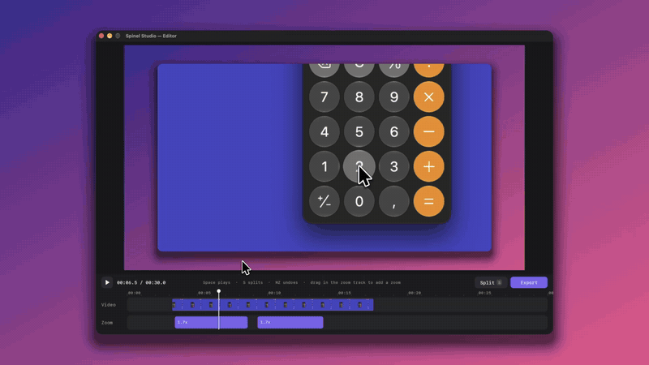
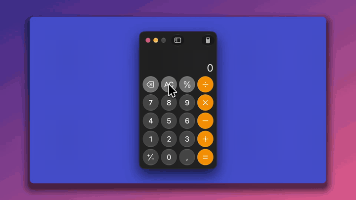
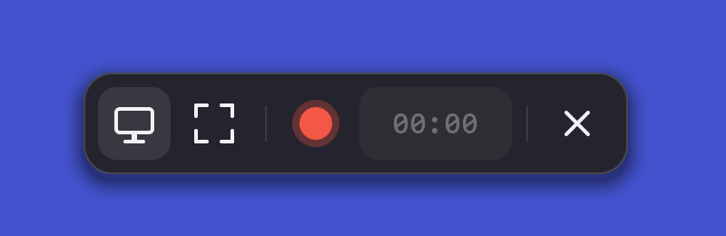

#  Spinel Studio

A screen recorder for macOS, written in Ruby and compiled to a native app by [Spinel](https://github.com/matz/spinel). It puts your recording on a wallpaper with rounded corners and a shadow, glides the cursor instead of shaking with your hand, and zooms in where you click. An editor cuts the take and adjusts the zooms before the export. ffmpeg only encodes and decodes the video; everything in between is Ruby. The only code that is not Ruby is a small bridge to ScreenCaptureKit in `native/capture.m`.



*The editor, recorded and exported with Spinel Studio itself ([MP4](docs/editing.mp4)).*

## What a take looks like



*A take of the Calculator, as exported ([MP4](docs/calculator.mp4)).*

## Build and run

You need macOS 14 or newer, [Homebrew](https://brew.sh) and a built Spinel compiler. `script/build` installs the libraries in the `Brewfile` when they are missing.

```sh
script/build                     # writes build/Spinel Studio.app
open "build/Spinel Studio.app"
```

`script/build` uses `$SPINEL` if you set it, and `spinel` from `PATH` otherwise. The first take asks for the Screen Recording permission.

## Record



A floating bar opens at the bottom of the screen. Pick **Display** or **Area** (drag a rectangle; Esc cancels) and press the red button. After a short countdown the bar shows the time. It stays on screen but out of the video, and so do the marks around a picked area. The red button, or Control+Option+S, stops the take, and it opens in the editor.

## Edit

| Key | Action |
| --- | --- |
| Space, or a click on the video | Play, pause |
| S | Split the clip at the playhead |
| ⌫ or Delete | Remove the selected clip or zoom |
| Up, Down | Zoom in or out more on the selected zoom |
| Cmd+Z, Shift+Cmd+Z | Undo, redo |
| Cmd+S | Save (every edit is saved anyway) |

Drag the playhead or click the ruler to move in the video. Drag the outer edge of a clip to trim it. Drag in an empty spot of the Zoom track to add a zoom, and drag a zoom or its edges to move or resize it. **Export** asks where to save, shows its progress in a small window (Cancel or Esc stops it), and opens the video when it is done.

## Projects

Each take is a project, saved as `NAME.spinelstudio` under `~/Movies/Spinel Studio`. Finder shows it as one document. Every edit is saved as you make it (Cmd+S saves again and says so), so you can close the editor and go on later: double-click the project in Finder, or press the folder button on the bar and pick it. Export writes the finished video; the project stays as it was.

## What is in it

- Display and area recording with ScreenCaptureKit, leaving the app's own windows out of the video.
- A wallpaper gradient, padding, rounded corners and a soft shadow.
- A cursor redrawn larger, smoothed by a spring, that dips on each click.
- Zooms made from the bursts of clicks, which ease in and out and follow the cursor near the edges.
- A timeline with a Video track (split, trim, delete) and a Zoom track (add, move, resize, amount), undo and redo.
- Export at 1920×1080 with ffmpeg's VideoToolbox encoder.
- Every setting in `config/application.json`: colors, fonts, shortcuts, encoding, timings. Override any of them in `~/Library/Application Support/Spinel Studio/settings.json`.

## Development

`script/test` runs the tests under CRuby, `script/render_check` exports a synthetic take with the compiled binary, and `script/static_raise_check` catches calls Spinel could not resolve. [ARCHITECTURE.md](ARCHITECTURE.md) explains the files of a take, the code layout and its rules. Spinel Studio follows the model of [Cap](https://github.com/CapSoftware/Cap), the open source screen recorder.
